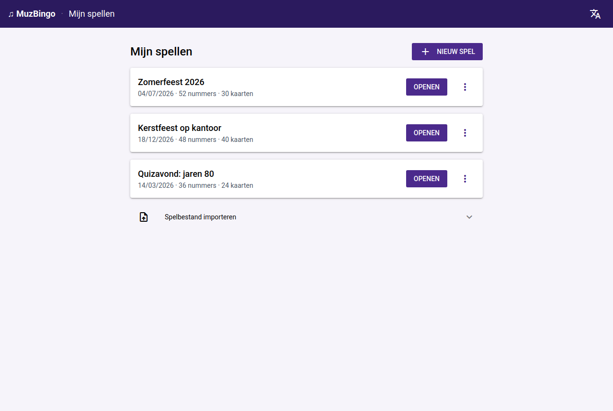
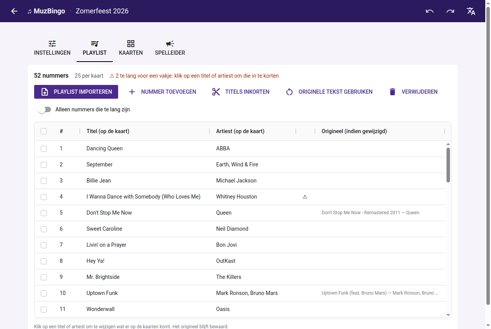
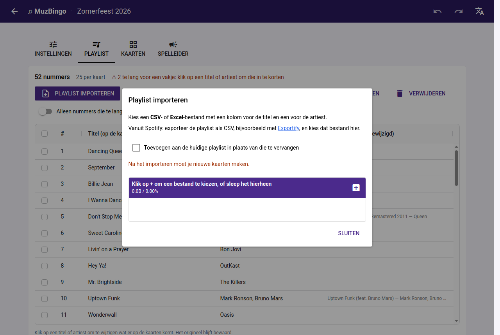
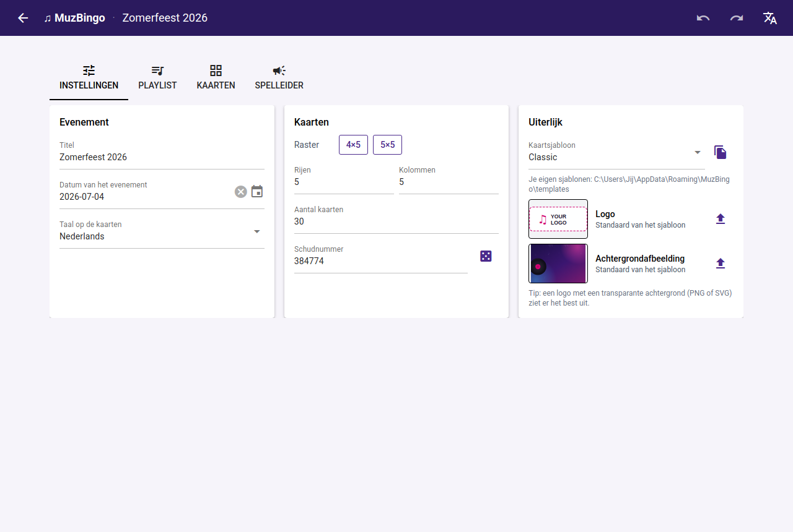
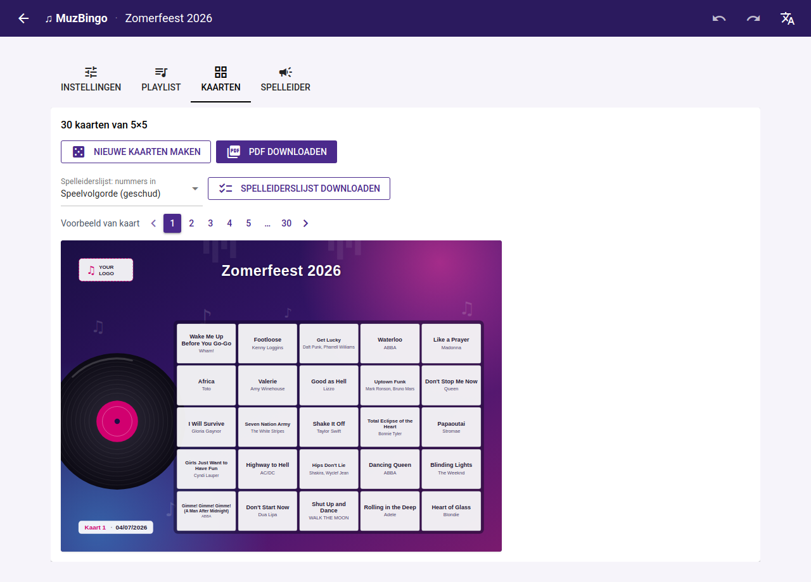
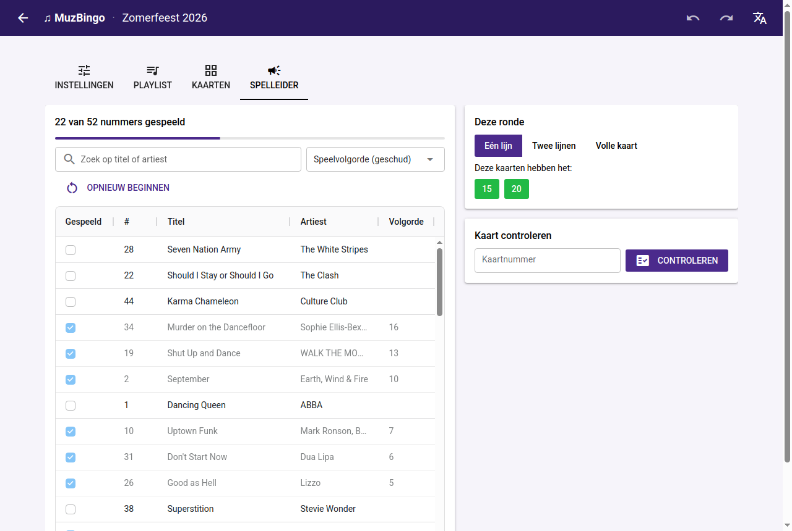
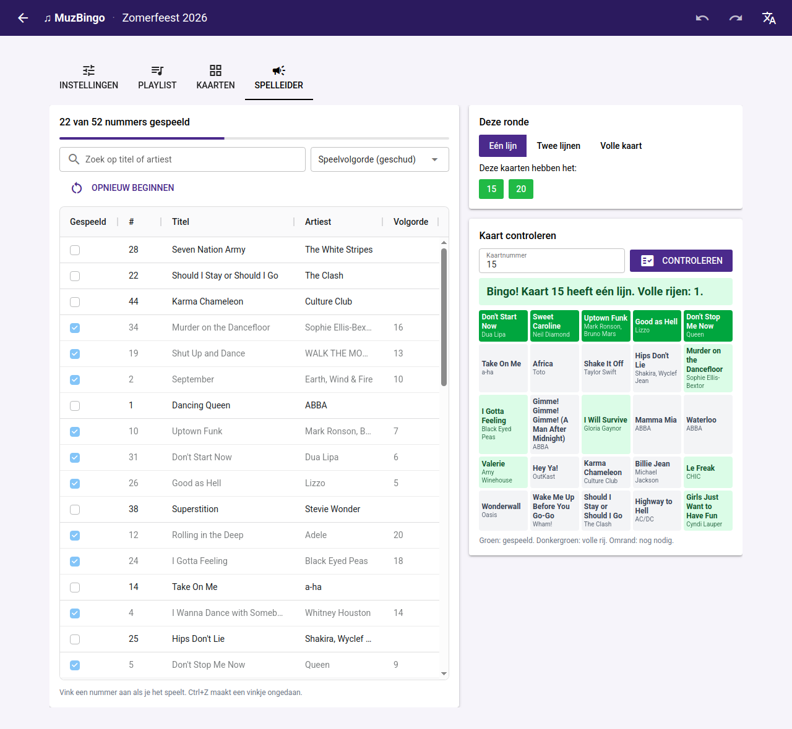

# Gebruikershandleiding MuzBingo

*English version: [User manual](user-manual.md)*

MuzBingo maakt kaarten voor **muziekbingo**. Je kiest een playlist, MuzBingo maakt voor
elke speler een andere kaart en jij drukt de kaarten af. Op het feest speel je de nummers;
de spelers duiden op hun kaart de nummers aan die ze herkennen. Wie als eerste een volle
rij heeft, roept "Bingo!".

Inhoud:

1. [Aan de slag](#1-aan-de-slag)
2. [Snel starten: je eerste spel in zes stappen](#2-snel-starten-je-eerste-spel-in-zes-stappen)
3. [Mijn spellen](#3-mijn-spellen)
4. [De playlist](#4-de-playlist)
5. [Instellingen](#5-instellingen)
6. [Kaarten: bekijken en afdrukken](#6-kaarten-bekijken-en-afdrukken)
7. [Het spel leiden](#7-het-spel-leiden)
8. [Goed om te weten](#8-goed-om-te-weten)
9. [Vragen en problemen](#9-vragen-en-problemen)

## 1. Aan de slag

**Installeren.** MuzBingo hoef je niet te installeren. Pak het zip-bestand uit waar je
wilt: in je map Documenten, op het bureaublad of op een USB-stick. Dubbelklik daarna op
**MuzBingo.exe**.

De eerste keer kan Windows de waarschuwing "Windows heeft uw pc beveiligd" tonen. Dat komt
doordat het programma niet ondertekend is. Klik op **Meer informatie** en daarna op **Toch
uitvoeren**.

**Taal.** De app is er in het Nederlands en het Engels. Klik rechtsboven op de taalknop
(文A) om te wisselen. Dat verandert alleen de app zelf; de taal die op de kaarten komt, is
een aparte instelling (zie [Instellingen](#5-instellingen)).

**Opslaan.** Je hoeft nooit op te slaan. Elke wijziging wordt meteen bewaard. Als je het
venster sluit, sluit je MuzBingo.

## 2. Snel starten: je eerste spel in zes stappen

1. Klik op **Mijn spellen** op **Nieuw spel**, typ een naam (bijvoorbeeld "Kerstfeest
   2026") en klik op **Aanmaken**.
2. Het venster **Playlist importeren** gaat open. Kies een CSV- of Excel-bestand met je
   nummers (zie [Een playlist maken](#een-playlist-maken)).
3. Vul op het tabblad **Instellingen** de datum van het evenement in en kies het raster
   (bijvoorbeeld 5×5) en het aantal kaarten: één per speler, plus een paar extra.
4. Klik op het tabblad **Kaarten** op **Kaarten maken**.
5. Klik op **PDF downloaden** en druk de PDF af: één kaart per pagina.
6. Open op het feest het tabblad **Spelleider** en vink elk nummer aan zodra je het
   speelt. MuzBingo laat zien welke kaarten een lijn hebben.

## 3. Mijn spellen

De startpagina toont al je spellen; het spel dat je het laatst gewijzigd hebt, staat
bovenaan. Onder elke titel zie je de datum, het aantal nummers en het aantal kaarten.

- **Nieuw spel**: maakt een leeg spel en opent meteen het importeren van de playlist. Een
  nieuw spel begint met het sjabloon, het raster en het aantal kaarten die je het laatst
  gebruikt hebt.
- **Openen** (of klik op de titel): opent het spel.
- Het menu met de drie puntjes (⋮) bevat:
  - **Dupliceren**: maakt een kopie, handig voor een gelijkaardig feest volgend jaar.
  - **Spelbestand downloaden**: bewaart het spel als `.muzbingo`-bestand, als reservekopie
    of om het naar een andere computer over te zetten.
  - **Verwijderen**: haalt het spel uit de lijst. Het is niet voorgoed weg: het gaat naar
    de map `trash` in de gegevensmap van MuzBingo (zie [Waar je spellen bewaard
    worden](#waar-je-spellen-bewaard-worden)).
- **Spelbestand importeren** (onderaan): voegt een `.muzbingo`-bestand toe, bijvoorbeeld
  een dat je op een andere computer hebt gedownload.

Met de pijl linksboven (of de naam **MuzBingo**) kom je altijd terug op deze pagina.

## 4. De playlist

### Een playlist maken

MuzBingo leest **CSV**-bestanden en **Excel**-bestanden (`.xlsx`). Het bestand heeft een
kolom met de titel van het nummer en een kolom met de artiest nodig.

- **Vanuit Spotify:** exporteer de playlist als CSV-bestand, bijvoorbeeld met
  [Exportify](https://exportify.app): log daar in met je Spotify-account en exporteer de
  playlist.
- **Je eigen lijst in Excel:** zet de titels in één kolom en de artiesten in een andere,
  elk met een kop in de eerste rij, zoals *Titel* en *Artiest*.

### Importeren

Klik op **Playlist importeren** en kies het bestand (of sleep het naar het venster).

- MuzBingo vindt zelf de kolommen met de titel en de artiest. Lukt dat niet, dan vraagt
  het programma het je: kies de **Kolom met de titel** en de **Kolom met de artiest** en
  klik op **Importeren**.
- Lege rijen en nummers die twee keer voorkomen, worden overgeslagen. MuzBingo meldt
  hoeveel.
- Normaal **vervangt** het importeren de playlist. Vink **Toevoegen aan de huidige
  playlist in plaats van die te vervangen** aan om de nummers toe te voegen aan de nummers
  die je al hebt.
- Heeft het spel al kaarten, dan moet je na het importeren nieuwe kaarten maken.

### Hoeveel nummers heb je nodig?

Op een kaart staan *rijen × kolommen* nummers: 25 voor een kaart van 5×5. De playlist moet
minstens zoveel nummers hebben. Met minder dan het dubbele (50 voor 5×5) lijken de kaarten
sterk op elkaar en is een spel snel voorbij; MuzBingo geeft dan een tip. Meer nummers geeft
een langer spel.

### Teksten die te lang zijn

De vakjes op een kaart zijn klein. Een ⚠ in de lijst betekent dat een titel of artiest te
lang is voor het vakje. Bovenaan staat voor hoeveel nummers dat geldt; zet **Alleen
nummers die te lang zijn** aan om alleen die te zien.

- **Een tekst wijzigen:** klik in de lijst op een titel of artiest en typ een kortere
  versie. Dat verandert alleen wat er op de kaarten komt. Het origineel blijft bewaard en
  staat in de kolom **Origineel (indien gewijzigd)**.
- **Titels inkorten:** verwijdert uitgave-details zoals "Remastered 2011", "Radio Edit" of
  "(feat. …)" uit de titels. Je ziet eerst een lijst met de oude en de nieuwe titel; vink
  de titels uit die je wilt laten zoals ze zijn en klik op **Geselecteerde titels
  inkorten**.
- **Originele tekst gebruiken:** selecteer nummers met de vakjes en klik op deze knop om
  weer hun originele titel en artiest af te drukken.

### Nummers toevoegen en verwijderen

- **Nummer toevoegen:** typ een titel en een artiest en klik op **Toevoegen**.
- **Verwijderen:** selecteer nummers met de vakjes ervoor en klik op **Verwijderen**.
  Staan er al nummers van op de kaarten, dan moet je nieuwe kaarten maken.

## 5. Instellingen

### Evenement

- **Titel**: komt bovenaan op elke kaart.
- **Datum van het evenement**: komt onderaan op elke kaart. Klik op het kalendertje om een
  datum te kiezen, of op het ✕ om de datum te wissen.
- **Taal op de kaarten**: de taal van de teksten op de kaart zelf, zoals "Kaart" of
  "Card". Dat staat los van de taal van de app.

### Kaarten

- **Raster**: het aantal rijen en kolommen. De knoppen **4×5** en **5×5** kiezen de
  gangbaarste formaten; je kunt ook zelf een formaat van 2 tot 8 invullen bij **Rijen** en
  **Kolommen**. Als je het raster verandert, worden meteen nieuwe kaarten gemaakt, want de
  oude passen niet meer.
- **Aantal kaarten**: hoeveel verschillende kaarten je wilt, tot 500. Maak er één per
  speler, plus een paar extra.
- **Schudnummer**: bepaalt hoe de nummers over de kaarten geschud worden. Hetzelfde nummer
  geeft altijd dezelfde kaarten. Klik op de dobbelsteen voor een nieuw nummer. Normaal hoef
  je hier niets aan te doen.

### Uiterlijk

- **Kaartsjabloon**: het ontwerp van de kaarten. MuzBingo heeft het sjabloon *Classic*.
- **Logo**: je eigen logo linksboven op de kaart, in plaats van het voorbeeld "Your logo".
  Klik op de uploadknop (⬆) en kies een afbeelding. Een logo met een transparante
  achtergrond (PNG of SVG) ziet er het best uit.
- **Achtergrondafbeelding**: je eigen achtergrond in plaats van die van het sjabloon.
- Afbeeldingen mogen PNG, JPG, SVG of WebP zijn, tot 25 MB. Heel grote foto's worden
  automatisch verkleind, zodat de PDF niet te groot wordt. Met de knop ↺ naast een
  afbeelding ga je terug naar de afbeelding van het sjabloon.
- **De kopieerknop** naast *Kaartsjabloon* maakt je eigen kopie van
  het sjabloon, die je kunt aanpassen. Dat is voor wie wat HTML en CSS kent: de kopie is een
  map met een bestand `style.css` dat je met een teksteditor aanpast. De regel onder het
  sjabloon toont waar de map staat. Het voorbeeld van de kaart toont je wijzigingen als je
  van tabblad wisselt.

## 6. Kaarten: bekijken en afdrukken

- **Kaarten maken** maakt de kaarten. Elke kaart heeft onderaan een nummer.
- **Nieuwe kaarten maken** schudt opnieuw. Alle kaarten veranderen, dus kaarten die je al
  hebt afgedrukt, passen dan niet meer bij het spel. MuzBingo vraagt het eerst.
- Verander je de playlist of de kaartinstellingen nadat je de kaarten gemaakt hebt, dan
  meldt een geel bericht dat. Maak nieuwe kaarten voor je afdrukt.
- **Voorbeeld van kaart**: klik op de paginanummers om de kaarten één voor één te bekijken.
- **PDF downloaden**: bewaart alle kaarten in één PDF, één kaart per A4-pagina (liggend).
  Druk af op ware grootte ("100%"), niet "aanpassen aan pagina".

### De spelleiderslijst

De spelleiderslijst is de playlist als checklist op papier, om de gespeelde nummers af te
vinken. Kies de volgorde bij **Spelleiderslijst: nummers in** en klik op
**Spelleiderslijst downloaden**:

- **Speelvolgorde (geschud)**: een willekeurige volgorde om de nummers in te spelen. Die
  blijft hetzelfde voor dit spel.
- **Volgorde van de playlist**, **Gesorteerd op artiest** of **Gesorteerd op titel**:
  handig om snel een nummer te vinden.

De kolom **Op kaarten** toont op hoeveel kaarten elk nummer staat.

## 7. Het spel leiden

Op het tabblad **Spelleider** houd je het spel bij op de computer.

- **Vink een nummer aan** in de kolom **Gespeeld** zodra je het speelt. De kolom
  **Volgorde** toont in welke volgorde de nummers gespeeld zijn (1 = eerste). Vergist?
  **Ctrl+Z** maakt het vinkje ongedaan.
- Met **Zoek op titel of artiest** vind je snel een nummer. De lijst ernaast sorteert de
  nummers in dezelfde volgordes als de spelleiderslijst.
- **Opnieuw beginnen** zet alle nummers op niet gespeeld, voor de volgende ronde. Ook dat
  kun je ongedaan maken.

### Deze ronde

Kies wat spelers nodig hebben om deze ronde te winnen:

- **Eén lijn**: één volle horizontale rij op de kaart.
- **Twee lijnen**: twee volle rijen.
- **Volle kaart**: alle nummers op de kaart.

Alleen horizontale rijen tellen; kolommen en diagonalen niet. Bij **Deze kaarten hebben
het** toont MuzBingo de nummers van de kaarten die gewonnen hebben, en er verschijnt een
melding zodra een kaart wint. Klik op een kaartnummer om die kaart te zien.

### Een kaart controleren

Roept een speler "Bingo!", typ dan het kaartnummer bij **Kaart controleren** en klik op
**Controleren**. MuzBingo zegt of de kaart gewonnen heeft, of hoeveel nummers ze nog nodig
heeft, en toont de kaart:

- **Groen**: het nummer is gespeeld.
- **Donkergroen**: hoort bij een volle rij.
- **Omrand**: nog nodig.

## 8. Goed om te weten

### Ongedaan maken en opnieuw

Met de pijlknoppen rechtsboven maak je je laatste wijzigingen in een spel ongedaan of doe
je ze opnieuw: een verwijderd nummer, een gewijzigde instelling, een vinkje op het tabblad
Spelleider. De sneltoetsen zijn **Ctrl+Z** (ongedaan maken) en **Ctrl+Y** (opnieuw).

### Waar je spellen bewaard worden

In de zip-versie staat alles in de map **data** naast MuzBingo.exe: je spellen
(`data\games`), verwijderde spellen (`data\games\trash`), je eigen sjablonen
(`data\templates`) en de instellingen. Staat MuzBingo op een USB-stick, dan gaan je spellen
dus mee.

Dat komt door het bestand `portable.txt` naast MuzBingo.exe. Verwijder je dat bestand, dan
bewaart MuzBingo zijn gegevens in je Windows-profiel (`%APPDATA%\MuzBingo`).

**Reservekopie en een andere computer:** gebruik **Spelbestand downloaden** op Mijn
spellen. Gebruik op de andere computer **Spelbestand importeren**.

### Muziekrechten en kansspelregels

MuzBingo maakt alleen de kaarten; het speelt, bevat of licentieert geen muziek. Ga na wat
er geldt waar je speelt voor je een muziekbingo organiseert: voor muziek op een evenement
heb je vaak een licentie nodig, en bingo met prijzen of inschrijfgeld kan onder de
kansspelregels vallen.

## 9. Vragen en problemen

**MuzBingo is al open, maar ik vind het venster niet.**
Start MuzBingo nog eens: het programma haalt dan het open venster naar voren in plaats van
een tweede keer te starten.

**Het importeren herkent de kolommen niet.**
Kies in het importvenster zelf de kolommen met de titel en de artiest. Controleer of de
eerste rij van het bestand de kolomkoppen bevat.

**Het importeren meldt "Onbekende tekstcodering".**
Het CSV-bestand is in een ongebruikelijke tekstcodering bewaard. Open het in Excel en sla
het opnieuw op als "CSV UTF-8" (*Bestand → Opslaan als*), of sla het op als Excel-bestand
en importeer dat.

**Ik kan geen kaarten maken.**
De playlist heeft minder nummers dan er op één kaart staan. Voeg nummers toe of kies op het
tabblad Instellingen een kleiner raster.

**"Kon niet genoeg verschillende kaarten maken".**
Er zijn te weinig nummers voor zoveel verschillende kaarten. Voeg nummers toe of maak minder
kaarten.

**De teksten op de kaarten zijn afgekapt of heel klein.**
Kort die titels of artiesten in op het tabblad Playlist: zoek naar het ⚠.

**Ik heb per ongeluk een spel verwijderd.**
Het staat in de map `trash` in de map met spellen (zie [Waar je spellen bewaard
worden](#waar-je-spellen-bewaard-worden)). De bestandsnamen zijn een code gevolgd door de
datum en het uur waarop je het spel verwijderd hebt, bijvoorbeeld
`…-20261122-183015.muzbingo` voor 22 november 2026 om 18.30 uur. Gebruik **Spelbestand
importeren** op Mijn spellen en kies dat bestand.

**Er loopt iets mis en ik weet niet waarom.**
MuzBingo schrijft meldingen naar `muzbingo.log` in de map `logs` van de gegevensmap. Stuur
dat bestand mee als je om hulp vraagt.
