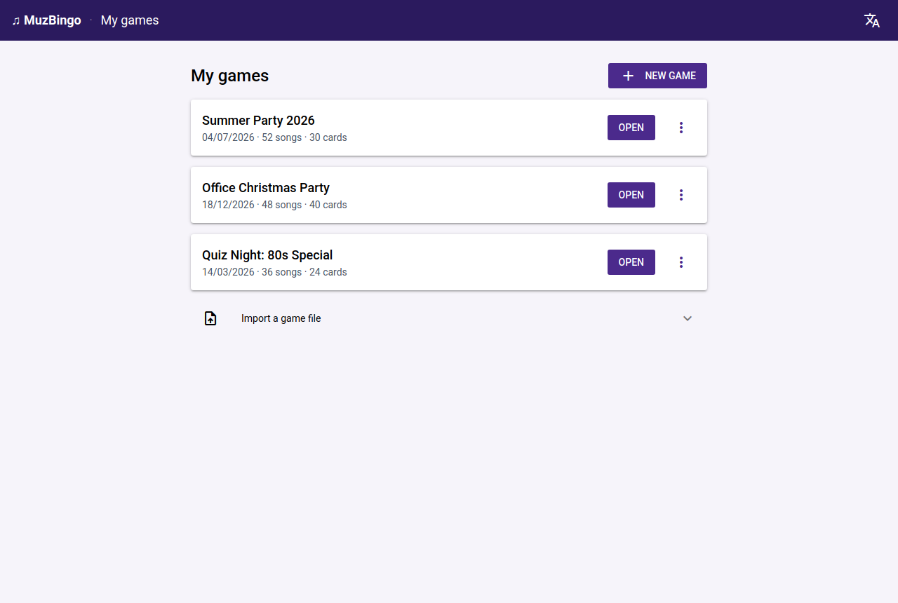
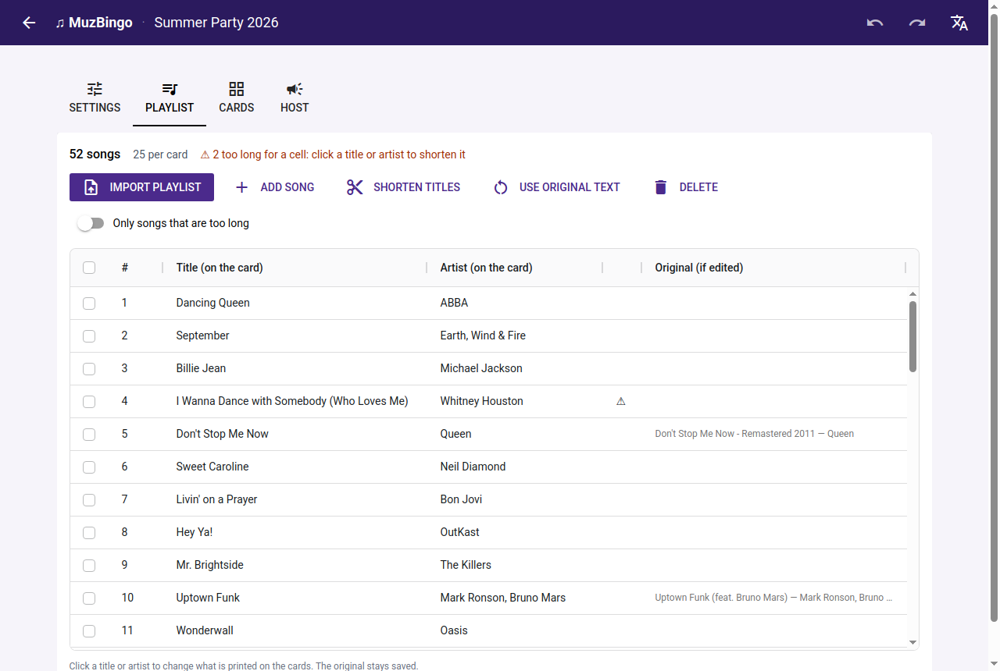
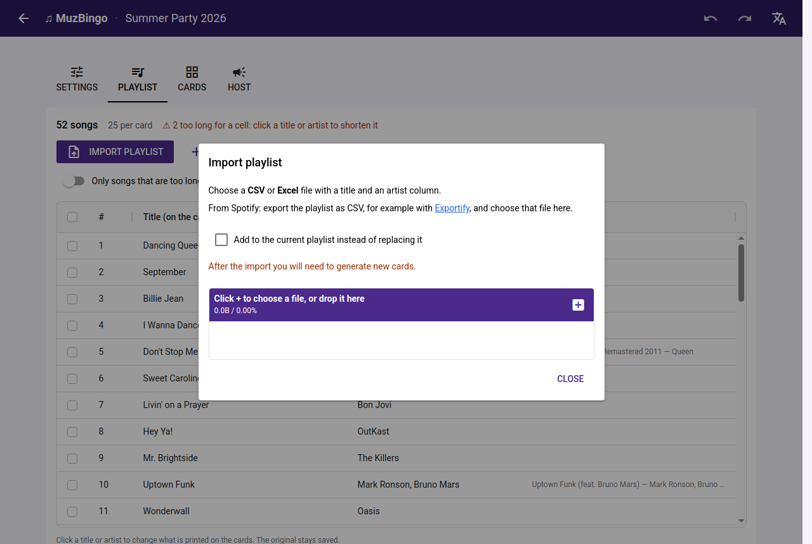
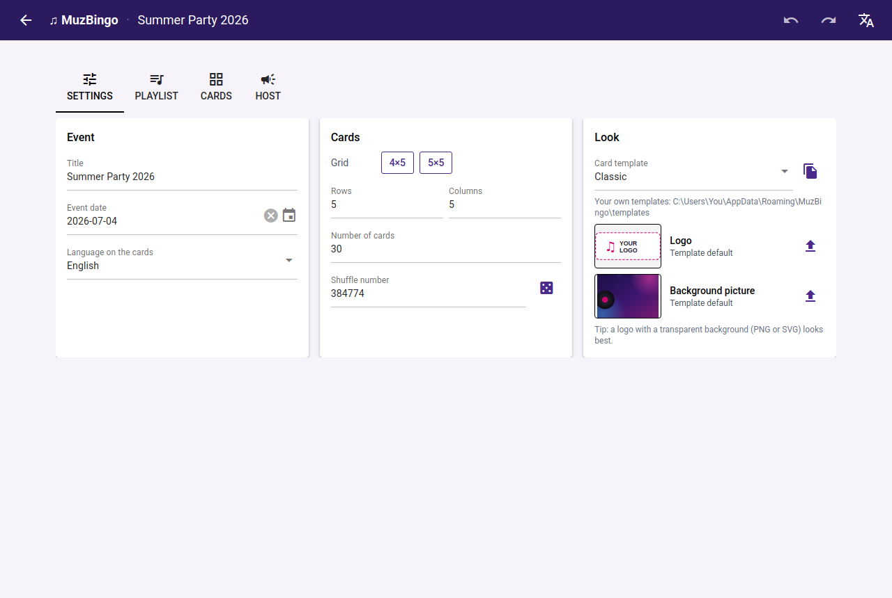
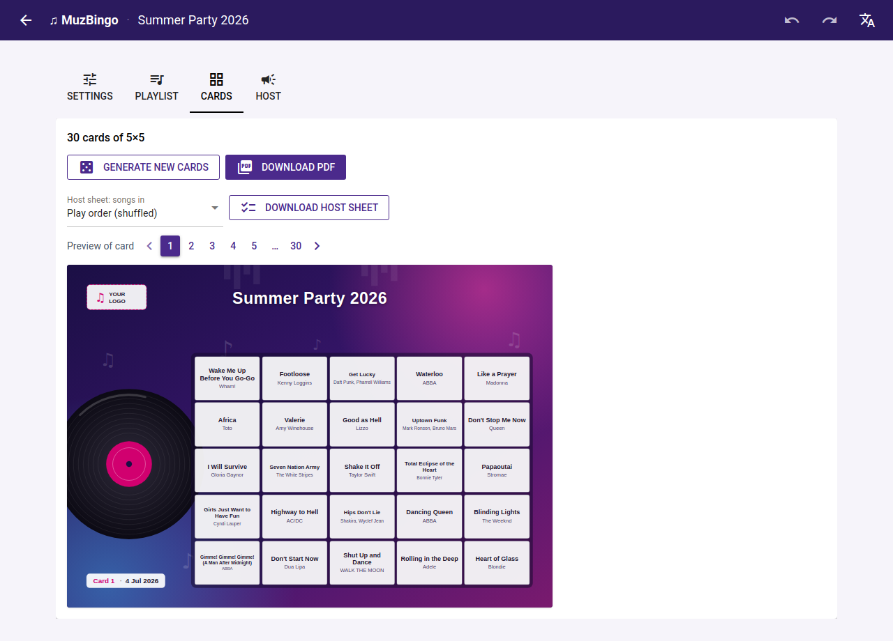
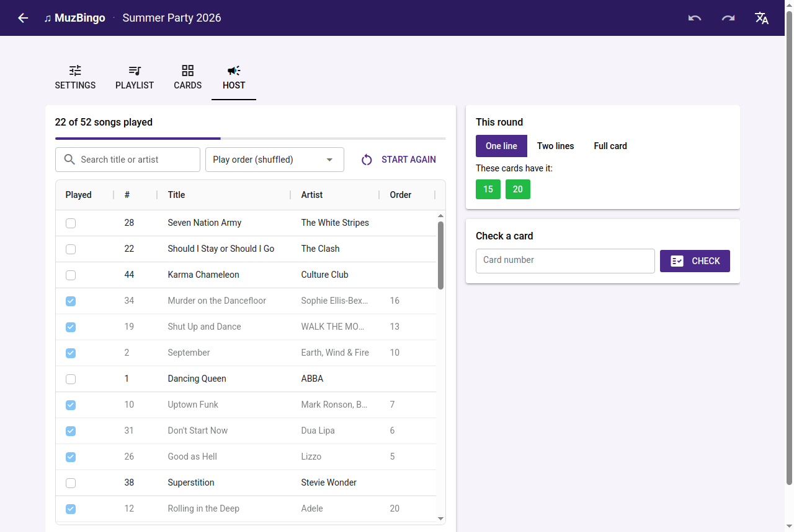
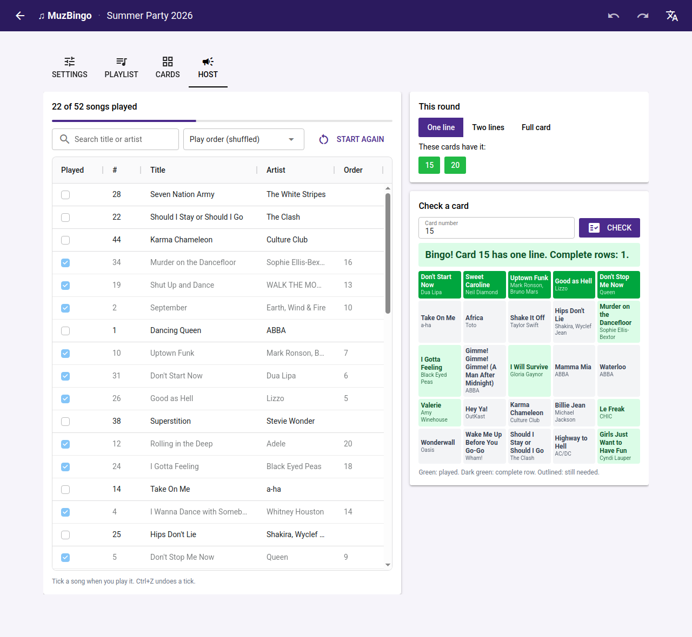

# MuzBingo user manual

*Nederlandse versie: [Gebruikershandleiding](gebruikershandleiding.md)*

MuzBingo makes **music bingo** cards. You choose a playlist, MuzBingo makes a different
card for every player, and you print the cards. During the party you play the songs;
players mark the songs they recognise on their card. The first player with a full row
calls "Bingo!".

Contents:

1. [Getting started](#1-getting-started)
2. [Quick start: your first game in six steps](#2-quick-start-your-first-game-in-six-steps)
3. [My games](#3-my-games)
4. [The playlist](#4-the-playlist)
5. [Settings](#5-settings)
6. [Cards: preview and print](#6-cards-preview-and-print)
7. [Hosting the game](#7-hosting-the-game)
8. [Good to know](#8-good-to-know)
9. [Questions and problems](#9-questions-and-problems)

## 1. Getting started

**Installing.** MuzBingo doesn't need to be installed. Unzip the zip file anywhere: in your
Documents folder, on the desktop, or on a USB stick. Then double-click **MuzBingo.exe**.

The first time, Windows may show the warning "Windows protected your PC". That's because
the program isn't signed. Click **More info**, then **Run anyway**.

**Language.** The app is in English and Dutch. Click the language button (文A) at the top right to
switch. This only changes the app itself; the language printed on the
cards is a separate setting (see [Settings](#5-settings)).

**Saving.** You never need to save. Every change is saved straight away. Closing the
window closes MuzBingo.

## 2. Quick start: your first game in six steps

1. On **My games**, click **New game**, type a name (for example "Christmas party 2026")
   and click **Create**.
2. The **Import playlist** window opens. Choose a CSV or Excel file with your songs
   (see [Getting a playlist](#getting-a-playlist)).
3. On the **Settings** tab, fill in the event date and choose the grid (for example 5×5)
   and the number of cards: one per player, plus a few spare.
4. On the **Cards** tab, click **Generate cards**.
5. Click **Download PDF** and print the PDF: one card per page.
6. At the party, open the **Host** tab and tick off each song as you play it. MuzBingo
   tells you which cards have a line.

## 3. My games

The start page lists all your games; the one you changed last is at the top. Under each title you see the
date, the number of songs and the number of cards.

- **New game**: makes an empty game and opens the playlist import straight away. A new
  game starts with the template, grid and number of cards you used last.
- **Open** (or click the title): opens the game.
- The menu with the three dots (⋮) has:
  - **Duplicate**: makes a copy, handy for a similar party next year.
  - **Download game file**: saves the game as a `.muzbingo` file, for a backup or to
    move it to another computer.
  - **Delete**: removes the game from the list. It isn't gone for good: it moves to the
    `trash` folder inside the MuzBingo data folder (see [Where your games are
    stored](#where-your-games-are-stored)).
- **Import a game file** (at the bottom): adds a `.muzbingo` file, for example one you
  downloaded on another computer.

The arrow at the top left (or the name **MuzBingo**) always brings you back to this page.

## 4. The playlist

### Getting a playlist

MuzBingo reads **CSV** files and **Excel** files (`.xlsx`). The file needs a column with
the song title and a column with the artist.

- **From Spotify:** export the playlist as a CSV file, for example with
  [Exportify](https://exportify.app): log in with your Spotify account there and export
  the playlist.
- **Your own list in Excel:** put the titles in one column and the artists in another,
  each with a heading in the first row, such as *Title* and *Artist*.

### Importing

Click **Import playlist** and choose the file (or drag it into the window).

- MuzBingo finds the title and artist columns by itself. If it can't, it asks: choose
  the **Title column** and the **Artist column**, then click **Import**.
- Empty rows and songs that appear twice are skipped. MuzBingo tells you how many.
- Normally the import **replaces** the playlist. Tick **Add to the current playlist
  instead of replacing it** to add the songs to the ones you already have.
- If the game already has cards, you need to generate new cards after the import.

### How many songs do you need?

A card holds *rows × columns* songs: 25 for a 5×5 card. The playlist needs at least that
many songs. With fewer than twice that number (50 for 5×5), the cards look a lot alike
and games end quickly; MuzBingo shows a tip then. More songs make a longer game.

### Texts that are too long

The cells on a card are small. A ⚠ in the list means a title or artist is too long to
fit in its cell. At the top MuzBingo shows how many songs that applies to; switch on
**Only songs that are too long** to see just those.

- **Change a text:** click a title or artist in the list and type a shorter version.
  This only changes what's printed on the cards. The original stays saved and is shown in
  the **Original (if edited)** column.
- **Shorten titles:** removes release details such as "Remastered 2011", "Radio Edit" or
  "(feat. …)" from the titles. You first see a list with the old and the new title; untick
  the ones you want to keep as they are, then click **Shorten selected titles**.
- **Use original text:** select songs with the checkboxes and click this button to print
  their original title and artist again.

### Adding and deleting songs

- **Add song:** type a title and an artist, then click **Add**.
- **Delete:** select songs with the checkboxes in front of them, then click **Delete**.
  If some of them are already on the cards, you need to generate new cards.

## 5. Settings

### Event

- **Title**: printed at the top of every card.
- **Event date**: printed at the bottom of every card. Click the calendar icon to pick
  a date, or the ✕ to remove it.
- **Language on the cards**: the language of the texts on the card itself, such as
  "Card" or "Kaart". This is separate from the app's language.

### Cards

- **Grid**: the number of rows and columns. The buttons **4×5** and **5×5** set the most
  common sizes; you can also type any size from 2 to 8 in **Rows** and **Columns**.
  Changing the grid makes new cards straight away, because the old ones no longer fit.
- **Number of cards**: how many different cards to make, up to 500. Make one per player,
  plus a few spare.
- **Shuffle number**: decides how the songs are shuffled over the cards. The same number
  always gives the same cards. Click the dice to pick a new number. You normally don't
  need to touch this.

### Look

- **Card template**: the design of the cards. MuzBingo comes with the template
  *Classic*.
- **Logo**: your own logo at the top left of the card, instead of the "Your logo"
  placeholder. Click the upload button (⬆) and choose a picture. A logo with a
  transparent background (PNG or SVG) looks best.
- **Background picture**: your own background instead of the template's.
- Pictures can be PNG, JPG, SVG or WebP, up to 25 MB. Very large photos are made smaller
  automatically, so the PDF stays a manageable size. The ↺ button next to a picture goes
  back to the template's own picture.
- **The copy button** next to *Card template* makes your own copy of
  the template that you can change. This is for people who know some HTML and CSS: the
  copy is a folder with a `style.css` file you edit in a text editor. The line under the
  template shows where the folder is. The card preview shows your changes when you switch
  tabs.

## 6. Cards: preview and print

- **Generate cards** makes the cards. Every card has a number at the bottom.
- **Generate new cards** shuffles again. All cards change, so cards you already printed
  no longer match the game. MuzBingo asks before it does this.
- If you change the playlist or the card settings after generating, a yellow message
  says so. Generate new cards before you print.
- **Preview of card**: click the page numbers to look at the cards one by one.
- **Download PDF**: saves all cards in one PDF, one card per A4 page (landscape). Print
  it at actual size ("100%"), not "fit to page".

### The host sheet

The host sheet is the playlist as a checklist on paper, to tick off the songs you play.
Choose the order under **Host sheet: songs in**, then click **Download host sheet**:

- **Play order (shuffled)**: a random order to play the songs in. It stays the same for
  this game.
- **Playlist order**, **Sorted by artist** or **Sorted by title**: handy for finding a
  song quickly.

The **On cards** column shows on how many cards each song appears.

## 7. Hosting the game

On the **Host** tab you keep track of the game on the computer.

- **Tick a song** in the **Played** column when you play it. The **Order** column shows
  in which order the songs were played (1 = first). Made a mistake? **Ctrl+Z** undoes
  the tick.
- **Search title or artist** finds a song quickly. The list next to it sorts the songs
  in the same orders as the host sheet.
- **Start again** marks all songs as not played, for the next round. You can undo this
  too.

### This round

Choose what players need to win this round:

- **One line**: one full horizontal row on the card.
- **Two lines**: two full rows.
- **Full card**: all songs on the card.

Only horizontal rows count; columns and diagonals don't. Under **These cards have it**
MuzBingo shows the numbers of the cards that have won, and a message pops up as soon as a
card wins. Click a card number to see that card.

### Check a card

When a player calls "Bingo!", type the card number under **Check a card** and click
**Check**. MuzBingo says whether the card has won, or how many songs it still needs, and
shows the card:

- **Green**: the song has been played.
- **Dark green**: part of a full row.
- **Outlined**: still needed.

## 8. Good to know

### Undo and redo

The arrow buttons at the top right undo and redo your last changes in a game: a deleted
song, a changed setting, a tick on the Host tab. The keyboard shortcuts are **Ctrl+Z**
(undo) and **Ctrl+Y** (redo).

### Where your games are stored

In the zip version, everything is in the **data** folder next to MuzBingo.exe: your games
(`data\games`), deleted games (`data\games\trash`), your own templates
(`data\templates`) and the settings. So if MuzBingo is on a USB stick, your games go with
it.

That's because of the file `portable.txt` next to MuzBingo.exe. If you delete that file,
MuzBingo keeps its data in your Windows profile instead
(`%APPDATA%\MuzBingo`).

**Backups and another computer:** use **Download game file** on My games. On the other
computer, use **Import a game file**.

### Music rights and gambling rules

MuzBingo only makes the cards; it doesn't play, include or license any music. Before you
host a music bingo, check what applies where you play: playing music at an event often
needs a licence, and bingo with prizes or an entry fee can fall under gambling rules.

## 9. Questions and problems

**MuzBingo is already open, but I can't find the window.**
Start MuzBingo again: it brings the open window to the front instead of starting a second
time.

**The import says it doesn't recognise the columns.**
Choose the title and artist columns yourself in the import window. Check that the first
row of the file holds the column headings.

**The import says "Unknown text encoding".**
The CSV file was saved in an unusual text encoding. Open it in Excel and save it again as
"CSV UTF-8" (*File → Save As*), or save it as an Excel file and import that.

**I can't generate cards.**
The playlist has fewer songs than one card needs. Add songs, or choose a smaller grid
on the Settings tab.

**"Could not generate enough different cards".**
There are too few songs for this many different cards. Add songs or make fewer cards.

**The texts on the cards are cut off or very small.**
Shorten those titles or artists on the Playlist tab: look for the ⚠.

**I deleted a game by mistake.**
It's in the `trash` folder inside the games folder (see [Where your games are
stored](#where-your-games-are-stored)). The file names are a code followed by the date and
time you deleted the game, for example `…-20261122-183015.muzbingo` for 22 November 2026
at 18:30. Use **Import a game file** on My games and choose that file.

**Something goes wrong and I don't know why.**
MuzBingo writes messages to `muzbingo.log` in the `logs` folder of the data folder.
Send that file along when you ask for help.
